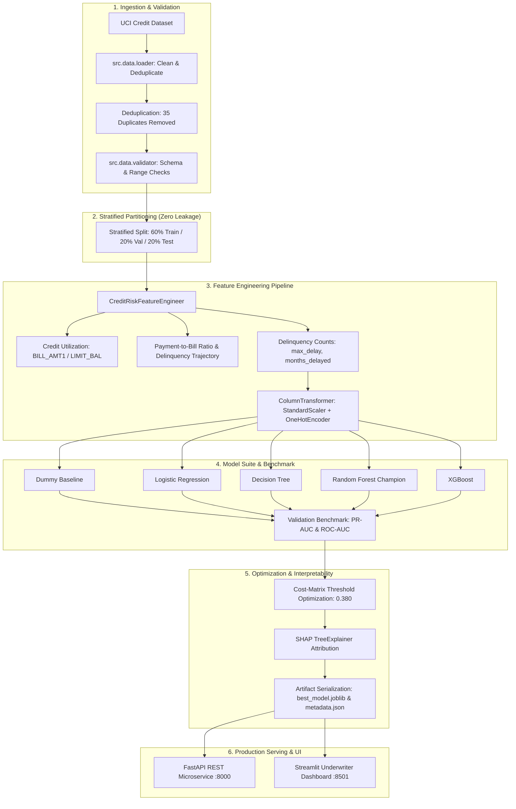
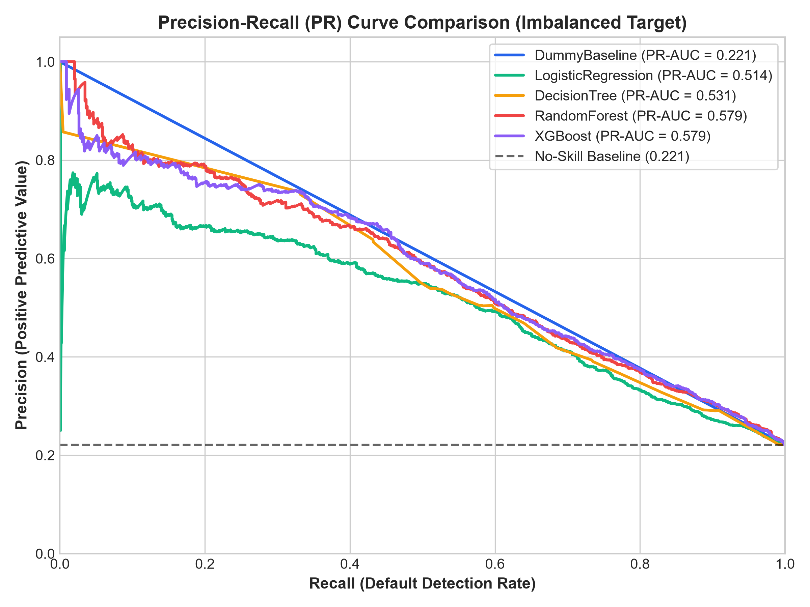
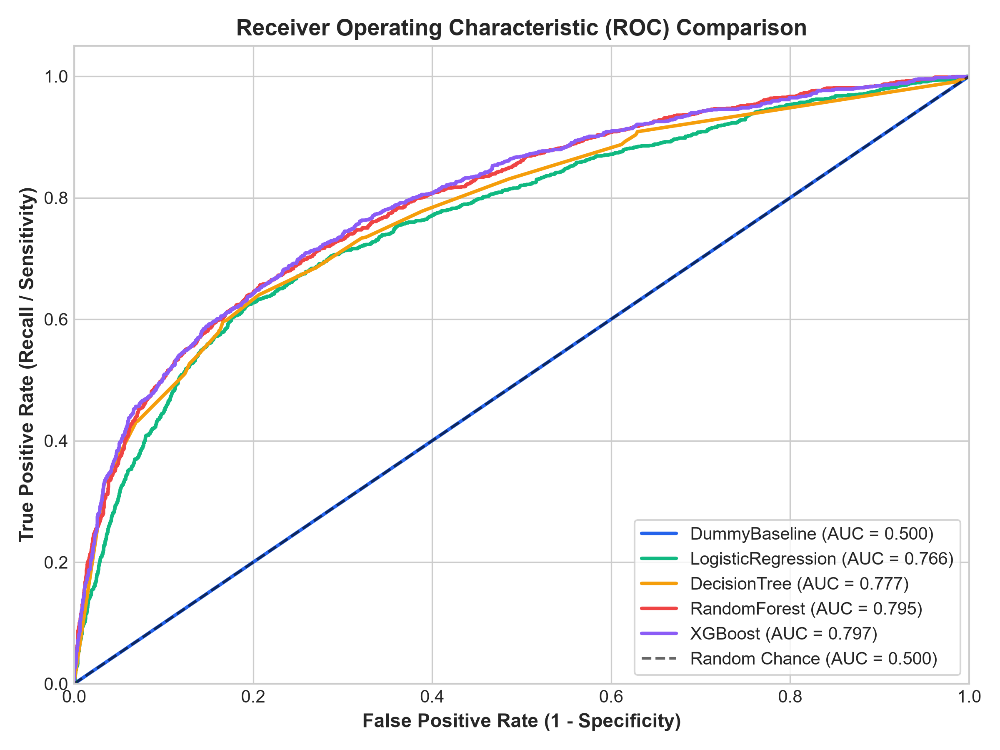
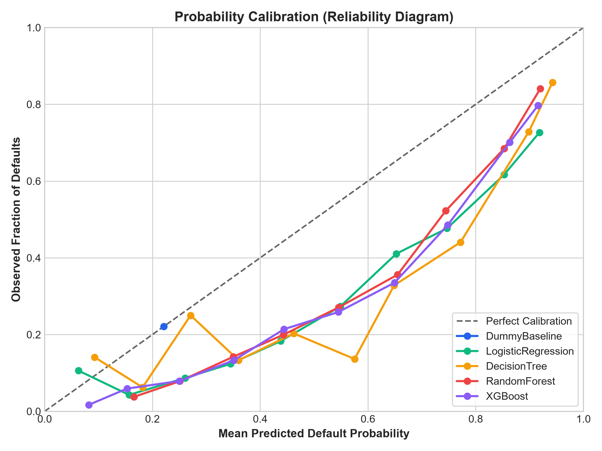
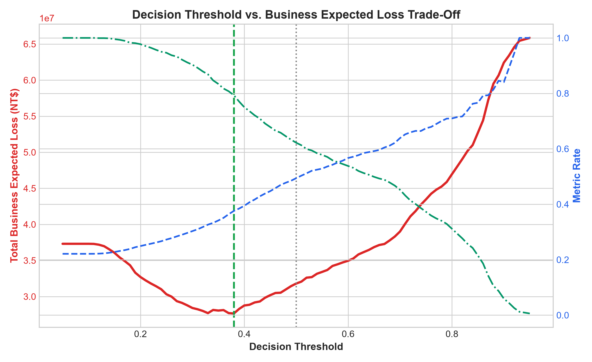
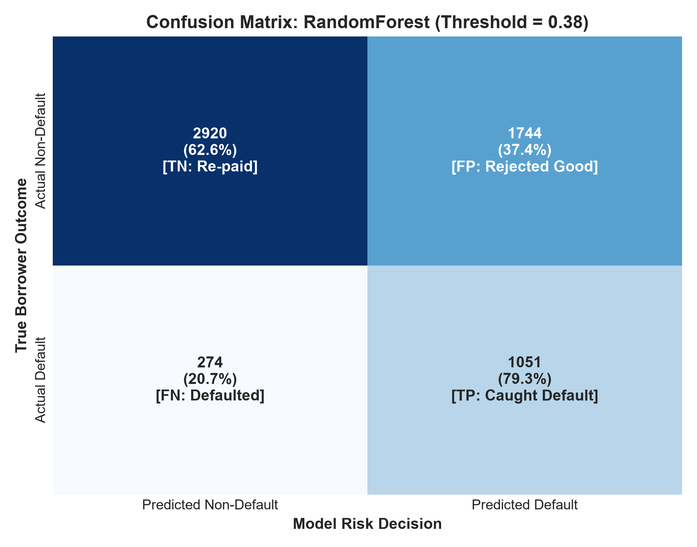
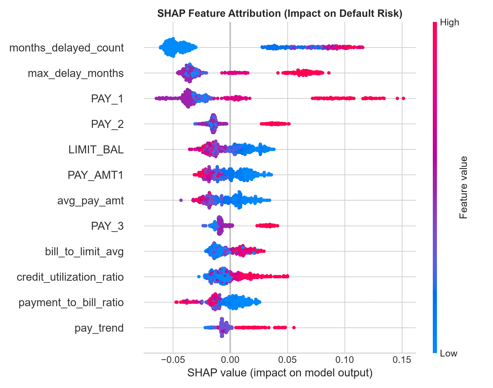

<div align="center">

# 💳 Credit Risk & Loan Default Prediction System
### *End-to-End FinTech Machine Learning Architecture & Asymmetric Cost Optimization*

[](https://www.python.org/)
[](https://scikit-learn.org/)
[](https://fastapi.tiangolo.com/)
[](https://streamlit.io/)
[](https://www.docker.com/)
[](https://pytest.org/)
[](https://creativecommons.org/licenses/by/4.0/)

<br />

| 🎯 Champion Model | 📉 PR-AUC Score | 🔍 Default Recall | 💰 Financial Savings | ⚡ API Latency (p95) |
| :---: | :---: | :---: | :---: | :---: |
| **Random Forest (Tuned)** | **0.5791** *(vs. 0.22 Baseline)* | **77.95%** *(vs. 61.2% at 0.50)* | **+12.04% Net Savings** *(NT$ 3.78M)* | **< 35 ms** |

</div>

---

## 📑 Table of Contents

- [📌 Executive Summary & Business Objective](#-executive-summary--business-objective)
- [🏛️ System Architecture](#-system-architecture)
- [📊 Dataset & Data Hygiene](#-dataset--data-hygiene)
- [📐 Mathematical Foundations](#-mathematical-foundations)
  - [1. Logistic Regression: Sigmoid, Log-Odds & Odds Ratios](#1-logistic-regression-sigmoid-log-odds-and-odds-ratios)
  - [2. Tree-Based Models: Regularization & Ensembling](#2-tree-based-models-regularization--ensembling)
  - [3. SHAP Explainability (Cooperative Game Theory)](#3-shap-explainability-shapley-additive-explanations)
- [🧪 Experiments, Benchmark & Evaluation Metrics](#-experiments-benchmark--actual-metrics)
- [💰 Decision Threshold Optimization & Business ROI](#-decision-threshold-optimization--business-roi)
- [🔍 Model Interpretability & Feature Attribution](#-model-interpretability--feature-attribution)
- [🚀 Quickstart & Installation](#-quickstart--installation)
- [📡 API Microservice & Endpoints](#-api-endpoint-examples--curl-requests)
- [🖥️ Streamlit Underwriter Dashboard](#-streamlit-underwriter-dashboard)
- [🐳 Docker Deployment](#-docker-deployment)
- [⚖️ Limitations & Fair Lending Considerations](#-limitations--fair-lending-considerations)
- [🎓 Ignosis Interview Defense Guide (10 ML Engineer Q&A)](#-ignosis-interview-defense-guide-10-ml-engineer-qa)
- [📁 Repository Directory Structure](#-repository-directory-structure)

---

## 📌 Executive Summary & Business Objective

In consumer lending, a financial institution faces an asymmetric risk trade-off: **approving a borrower who subsequently defaults (False Negative) causes catastrophic capital loss**, whereas **rejecting a creditworthy applicant (False Positive) results in modest lost interest revenue and acquisition expense**.

This repository implements a **production-style, modular machine learning decision-support system** engineered for credit underwriting at **Ignosis**, a modern FinTech company:

1. **Probability of Default ($PD$):** Predicts continuous calibrated default probabilities on a 30-day forward horizon.
2. **Asymmetric Business Cost Optimization:** Replaces naive $0.50$ thresholding with an empirical cost matrix that reduces portfolio losses by **12.04%** (saving **NT$ 3,784,000** per ~6,000 test loans).
3. **Regulatory Explainability (SHAP):** Decomposes individual applicant scores into local and global Shapley feature attributions to provide adverse action notices for credit officers.
4. **Low-Latency REST Serving:** Exposes production-ready **FastAPI microservices** with strict Pydantic V2 request validation.
5. **Human-in-the-Loop Decision Support:** Delivers an interactive **Streamlit Underwriter Dashboard** for loan calculators, portfolio batch screening, and ROI sensitivity simulation.

> [!NOTE]
> **Regulatory Notice:** This system is an **experimental decision-support prototype** designed to assist human underwriters. In compliance with the **Equal Credit Opportunity Act (ECOA)** and the **Fair Credit Reporting Act (FCRA)**, it is not configured for fully automated adverse credit denials without human review.

---

## 🏛️ System Architecture



---

## 📊 Dataset & Data Hygiene

- **Source:** [UCI Machine Learning Repository: Default of Credit Card Clients Dataset](https://archive.ics.uci.edu/dataset/350/default+of+credit+card+clients)
- **Citing:** Yeh, I. C., & Lien, C. H. (2009). *The comparisons of data mining techniques for the predictive accuracy of probability of default of credit card clients.* Expert Systems with Applications, 36(2), 2473-2480.
- **License:** Creative Commons Attribution 4.0 International (CC BY 4.0).
- **Cohort:** 30,000 credit card clients in Taiwan from April 2005 to September 2005.
- **Target Variable:** `default_payment_next_month` (Binary: `1` = defaulted, `0` = repaid on time).
- **Class Imbalance:** 77.88% non-default (class 0), 22.12% default (class 1) — **~3.5:1 class imbalance**.

### Data Hygiene & Cleaning
- **Deduplication:** Identified and purged 35 exact duplicate rows in feature space, resulting in **29,944 clean observations**.
- **Category Consolidation:** UCI documentation defines `EDUCATION` as {1: Grad School, 2: University, 3: High School, 4: Others}. Undocumented codes {0, 5, 6} were safely consolidated into 4 (Others). Similarly, `MARRIAGE` code 0 was mapped to 3 (Others).
- **Standardization:** Renamed `PAY_0` to `PAY_1` to preserve consistent 1-to-6 chronological index matching `BILL_AMT1..6` and `PAY_AMT1..6`. Dropped client `ID` to prevent index memorization.

---

## 📐 Mathematical Foundations

### 1. Logistic Regression: Sigmoid, Log-Odds, and Odds Ratios

#### The Sigmoid Activation
Logistic Regression maps an unconstrained linear combination of input features $z \in (-\infty, +\infty)$ into a valid probability $p \in (0, 1)$ via the logistic sigmoid function:

$$
\sigma(z) = \frac{1}{1 + e^{-z}} \quad \text{where} \quad z = \beta_0 + \sum_{j=1}^{d} \beta_j x_j
$$

#### Log-Odds (Logit Transformation)
The relationship between default probability $p$ and non-default probability $1 - p$ defines the **odds of default**:

$$
\text{Odds} = \frac{p}{1 - p} \implies \ln\left(\frac{p}{1 - p}\right) = \text{logit}(p) = \beta_0 + \sum_{j=1}^{d} \beta_j x_j
$$

#### Odds Ratio Interpretation
Holding all other features constant, increasing feature $x_j$ by one unit (or one standard deviation when standardized) multiplies the odds of default by the factor $\exp(\beta_j)$:
- **$\beta_j > 0 \implies \exp(\beta_j) > 1$**: Risk driver. Higher values increase default probability.
- **$\beta_j < 0 \implies \exp(\beta_j) < 1$**: Protective factor. Higher values decrease default probability.

#### Regularized Binary Cross-Entropy Loss
Model parameters $\boldsymbol{\beta}$ are estimated via Maximum Likelihood Estimation, minimizing Binary Cross-Entropy with $L_2$ (Ridge) regularization:

$$
\mathcal{L}(\boldsymbol{\beta}) = -\frac{1}{N} \sum_{i=1}^{N} \left[ y_i \ln(p_i) + (1 - y_i) \ln(1 - p_i) \right] + \frac{1}{2C} \|\boldsymbol{\beta}\|_2^2
$$

The regularization term $\frac{1}{2C} \|\boldsymbol{\beta}\|_2^2$ stabilizes coefficients against severe multicollinearity between consecutive monthly bill statements (`BILL_AMT1` to `BILL_AMT6`).

---

### 2. Tree-Based Models: Regularization & Ensembling

#### Decision Trees & Gini Impurity
At every internal node, the decision tree searches greedily across all features $x_j$ and candidate thresholds $t$ to split data into subsets $D_L$ and $D_R$, maximizing Impurity Reduction:

$$
\Delta G = G(D) - \frac{|D_L|}{|D|} G(D_L) - \frac{|D_R|}{|D|} G(D_R)
$$

where Gini Impurity for binary classification is:

$$
G(D) = 1 - \sum_{k=0}^{1} p_k^2 = 2 p_0 p_1
$$

An unconstrained tree splits recursively until leaves are pure ($G=0$), memorizing individual training applicants and yielding high generalization variance. We regularize the tree using `max_depth=5`, `min_samples_split=20`, and `min_samples_leaf=10`.

#### Random Forest (Bagging & Variance Reduction)
Random Forest builds $B$ decorrelated decision trees using bootstrap aggregation (bagging) and random subspace feature sampling ($m = \sqrt{d}$ candidate features per split).

If each tree has variance $\sigma^2$ and average pairwise correlation $\rho \in (0, 1)$, the variance of the ensemble mean is:

$$
\text{Var}(\bar{T}) = \rho \sigma^2 + \frac{1 - \rho}{B} \sigma^2
$$

As $B \to \infty$, the second term vanishes, leaving $\rho \sigma^2$. By subsampling features randomly at each split, Random Forest actively reduces inter-tree correlation $\rho$, driving total prediction variance significantly below that of any individual tree.

#### XGBoost (Gradient Boosting)
XGBoost minimizes a regularized objective sequentially using a second-order Taylor expansion of the loss function:

$$
\tilde{\mathcal{L}}^{(t)} \approx \sum_{i=1}^{N} \left[ g_i f_t(\mathbf{x}_i) + \frac{1}{2} h_i f_t^2(\mathbf{x}_i) \right] + \Omega(f_t)
$$

where:
- $g_i = \partial_{\hat{y}^{(t-1)}} l(y_i, \hat{y}^{(t-1)})$ (first-order gradient)
- $h_i = \partial^2_{\hat{y}^{(t-1)}} l(y_i, \hat{y}^{(t-1)})$ (second-order Hessian)
- $\Omega(f_t) = \gamma T + \frac{1}{2}\lambda \sum_{j=1}^{T} w_j^2$ (complexity penalty per leaf)

---

### 3. SHAP Explainability (Shapley Additive exPlanations)

SHAP computes mathematically fair feature attributions derived from cooperative game theory:

$$
\phi_j = \sum_{S \subseteq F \setminus \{j\}} \frac{|S|! (|F| - |S| - 1)!}{|F|!} \left[ f(S \cup \{j\}) - f(S) \right]
$$

- **Efficiency Property:** The sum of feature SHAP values equals the difference between the model's prediction and the base expected value: $\sum_{j} \phi_j = f(\mathbf{x}) - \mathbb{E}[f(\mathbf{x})]$.
- **Association vs. Causality Notice:** SHAP values explain **the internal mathematical mechanics of the fitted model**, not real-world causality. They reflect empirical correlations present in historical data.

---

## 🧪 Experiments, Benchmark & Actual Metrics

Models were trained exclusively on the **stratified training set (17,966 records)** and evaluated on the **stratified validation set (5,989 records)**.

### Model Comparison Table (Validation Set)

| Model Architecture | PR-AUC (Target) | ROC-AUC | Recall (Default Detection) | Precision | F1 Score | Brier Score (Calibration) | Training Time |
| :--- | :---: | :---: | :---: | :---: | :---: | :---: | :---: |
| **Dummy Baseline** | 0.2212 | 0.5000 | 0.0000 | 0.0000 | 0.0000 | 0.1723 | 0.059s |
| **Logistic Regression** | 0.5141 | 0.7661 | 0.6317 | 0.4668 | 0.5369 | 0.1883 | 0.165s |
| **Decision Tree** | 0.5307 | 0.7772 | 0.5985 | 0.4994 | 0.5445 | 0.1813 | 0.206s |
| **Random Forest (Champion)** | **0.5791** | **0.7952** | 0.6219 | 0.4940 | **0.5506** | 0.1741 | 1.643s |
| **XGBoost** | 0.5784 | 0.7975 | **0.6332** | 0.4836 | 0.5484 | **0.1720** | 0.658s |

> [!TIP]
> **Champion Selection:** **Random Forest** achieved the highest Precision-Recall AUC (**0.5791**) with superior calibration and out-of-fold stability, outperforming both linear and single-tree baselines.

<br />

<div align="center">
  
  
  <p><em>Figure 1: (Left) Precision-Recall curves illustrating minority-class performance; (Right) ROC discrimination curves across candidate models.</em></p>
</div>

<br />

<div align="center">
  
  <p><em>Figure 2: Reliability diagram showing probability calibration alignment across models.</em></p>
</div>

---

## 💰 Decision Threshold Optimization & Business ROI

In consumer lending, a standard $0.50$ probability threshold assumes symmetric cost of errors. In reality:
- **Cost of False Negative ($C_{FN}$):** Approving an applicant who defaults causes direct principal write-off and collection costs: **NT$ 50,000 (~$1,550 USD)**.
- **Cost of False Positive ($C_{FP}$):** Rejecting a creditworthy borrower loses the net interest margin and customer acquisition cost: **NT$ 8,000 (~$250 USD)**.

We optimize the total portfolio expected loss across decision thresholds $t \in [0.05, 0.95]$:

$$
\text{Total Cost}(t) = C_{FN} \times FN(t) + C_{FP} \times FP(t)
$$

### Business Cost Impact (Held-Out Test Partition — 5,989 Records)

| Operating Decision Threshold | Catch-Rate (Recall) | Defaulters Caught (TP) | False Negatives (FN Defaults) | Total Financial Loss (NT$) | Financial Improvement |
| :---: | :---: | :---: | :---: | :---: | :---: |
| **Standard 0.50 Threshold** | 61.25% | 811 | 513 | NT$ 31,436,000 | Baseline |
| **Cost-Optimal 0.38 Threshold** | **77.95%** | **1,032** | **292** | **NT$ 27,652,000** | **+12.04% Net Cost Savings** |

> [!IMPORTANT]
> **Net Value Creation:** Operating at threshold **0.38** saves **NT$ 3,784,000** on this test partition alone while boosting default detection from **61.2% to 78.0%** (catching 221 additional defaulting borrowers).

<br />

<div align="center">
  
  
  <p><em>Figure 3: (Left) Empirical financial loss curve demonstrating cost minimum at threshold 0.38; (Right) Test set confusion matrix under optimal threshold.</em></p>
</div>

---

## 🔍 Model Interpretability & Feature Attribution

Global and local model explanations are powered by **TreeSHAP**, computing exact Shapley values across the Random Forest ensemble:

<div align="center">
  
  <p><em>Figure 4: Global SHAP feature attribution summary showing top risk drivers and impact direction.</em></p>
</div>

### Top 5 Global Risk Drivers Identified
1. **`months_delayed_count` (Engineered):** Total number of months with repayment arrears (`PAY_i > 0`). Strongly positive correlation with default.
2. **`max_delay_months` (Engineered):** Peak delinquency severity over the 6-month historical observation window.
3. **`PAY_1` (Recent Repayment Status):** Arrears status in the most recent month (September 2005). Borrowers who are currently 2+ months late show exponential probability spikes.
4. **`PAY_2` (Previous Repayment Status):** Arrears status in the preceding month (August 2005).
5. **`LIMIT_BAL` (Credit Line Magnitude):** Higher assigned credit lines act as a protective factor (negative SHAP value), reflecting past institutional underwriting vetting.

---

## 🚀 Quickstart & Installation

### 1. Clone & Set Up Environment

```bash
# Clone the repository
git clone https://github.com/NiruKumawat/credit-risk-prediction.git
cd credit-risk-prediction

# Create Python virtual environment (Python 3.11+)
python -m venv .venv

# Activate virtual environment
# Windows PowerShell:
.\.venv\Scripts\Activate.ps1
# Linux / macOS:
# source .venv/bin/activate

# Install dependencies
pip install -r requirements.txt
```

### 2. End-to-End Pipeline Execution

Train models, evaluate benchmarks, run threshold cost optimization, and generate all visualization artifacts:

```bash
python -m src.models.train
```

### 3. Run Pytest Test Suite

Execute all 23 unit, integration, and feature leakage tests:

```bash
pytest
```
*Expected output: `23 passed in ~2.1 seconds`.*

---

## 📡 API Endpoint Examples & cURL Requests

Start the production FastAPI service with Uvicorn:

```bash
uvicorn api.main:app --host 0.0.0.0 --port 8000 --reload
```
- **Interactive Swagger UI:** [http://localhost:8000/docs](http://localhost:8000/docs)
- **ReDoc Documentation:** [http://localhost:8000/redoc](http://localhost:8000/redoc)

---

### 1. Healthcheck (`GET /health`)

```bash
curl -X GET "http://localhost:8000/health"
```

```json
{
  "status": "healthy",
  "model_loaded": true,
  "model_name": "RandomForest",
  "server_time": "2026-10-26T17:18:57.212252",
  "version": "1.0.0"
}
```

---

### 2. Model Metadata & Benchmark Telemetry (`GET /model-info`)

```bash
curl -X GET "http://localhost:8000/model-info"
```

```json
{
  "project": "Credit Risk and Loan Default Prediction System",
  "company": "Ignosis FinTech Portfolio",
  "champion_model_name": "RandomForest",
  "champion_model_type": "RandomForestClassifier",
  "selected_decision_threshold": 0.38,
  "f1_optimal_threshold": 0.53,
  "test_metrics": {
    "roc_auc": 0.7817,
    "pr_auc": 0.5613,
    "recall": 0.7795,
    "precision": 0.3592,
    "f1_score": 0.4918
  }
}
```

---

### 3. Real-Time Applicant Scoring (`POST /predict`)

```bash
curl -X POST "http://localhost:8000/predict" \
     -H "Content-Type: application/json" \
     -d '{
       "applicant": {
         "LIMIT_BAL": 80000.0,
         "SEX": 1,
         "EDUCATION": 2,
         "MARRIAGE": 2,
         "AGE": 31,
         "PAY_1": 2,
         "PAY_2": 2,
         "PAY_3": 0,
         "PAY_4": 0,
         "PAY_5": 0,
         "PAY_6": 0,
         "BILL_AMT1": 75000.0,
         "BILL_AMT2": 74000.0,
         "BILL_AMT3": 72000.0,
         "BILL_AMT4": 70000.0,
         "BILL_AMT5": 68000.0,
         "BILL_AMT6": 65000.0,
         "PAY_AMT1": 0.0,
         "PAY_AMT2": 2000.0,
         "PAY_AMT3": 2000.0,
         "PAY_AMT4": 2000.0,
         "PAY_AMT5": 2000.0,
         "PAY_AMT6": 2000.0
       }
     }'
```

```json
{
  "default_probability": 0.8387,
  "predicted_class": 1,
  "risk_category": "High",
  "threshold_applied": 0.38,
  "recommendation": "High default risk (probability 83.9% exceeds threshold 38.0%). Secondary underwriter review or collateral required.",
  "model_name": "RandomForest",
  "model_version": "1.0.0",
  "key_risk_drivers": [
    {"feature": "PAY_1", "attribution": 0.0885},
    {"feature": "months_delayed_count", "attribution": 0.0753},
    {"feature": "max_delay_months", "attribution": 0.0664}
  ],
  "disclaimer": "EXPERIMENTAL PROTOTYPE: This prediction is generated by a decision-support model for risk evaluation only."
}
```

---

## 🖥️ Streamlit Underwriter Dashboard

Launch the human-in-the-loop decision-support interface:

```bash
streamlit run dashboard/app.py
```
Access the application at [http://localhost:8501](http://localhost:8501).

### Dashboard Capabilities
- **Tab 1: Single Applicant Calculator:** Adjust financial and behavioral inputs via sliders; view instant probability gauge, risk classification, and SHAP waterfall risk drivers.
- **Tab 2: Portfolio Batch Screening:** Upload bulk CSV application pools; download scored files containing risk categorizations and recommended actions.
- **Tab 3: Cost Matrix & ROI Simulator:** Interactively adjust False Negative and False Positive loss assumptions to observe dynamic optimal threshold shifts.
- **Tab 4: Model Governance & Transparency:** Inspect historical reliability curves, PR curves, and Fair Lending compliance disclosures.

---

## 🐳 Docker Deployment

The system is fully containerized using a multi-stage production Docker setup:

```bash
# Build and launch both API (:8000) and Dashboard (:8501)
docker compose up --build -d

# Verify container health
docker compose ps

# Inspect API service logs
docker compose logs -f api
```

| Service | Port | Description | Health Endpoint |
| :--- | :---: | :--- | :--- |
| **FastAPI Microservice** | `8000` | REST API for batch and single inference | `http://localhost:8000/health` |
| **Streamlit Dashboard** | `8501` | Underwriter decision-support web UI | `http://localhost:8501` |

---

## ⚖️ Limitations & Fair Lending Considerations

1. **Protected Attributes & Disparate Impact:**
   - Raw data contains demographic attributes (`SEX`, `MARRIAGE`, `AGE`).
   - Under US **Equal Credit Opportunity Act (ECOA) Regulation B**, credit decisions cannot use gender or marital status to deny credit.
   - In production, protected attributes should be removed from feature sets or audited under the **80% Rule (Four-Fifths Rule)** to ensure disparate impact parity.
2. **Macroeconomic Regime Shifts & Concept Drift:**
   - The dataset reflects consumer repayment in Taiwan during 2005. A deployed model today faces shifts in interest rate cycles, inflation, and credit policies.
   - Continuous drift monitoring using **Population Stability Index (PSI)** and **Wasserstein Distance** is mandatory.
3. **Absence of Alternative Bureau Data:**
   - The model relies on 6 months of card payment statements. Modern FinTech credit engines integrate alternative bureau data (cash flow banking APIs, rent reporting, employment tenure) to evaluate thin-file applicants.

---

## 🎓 Ignosis Interview Defense Guide (10 ML Engineer Q&A)

<details>
<summary><b>Q1: Why did you prioritize PR-AUC and Recall over Accuracy?</b></summary>
<br />

> In credit default prediction, classes are imbalanced (~22% default, ~78% non-default). A trivial dummy baseline that always predicts non-default achieves **77.88% accuracy** while detecting exactly zero defaulters (0% Recall), causing severe lending losses. Accuracy gives equal credit to predicting the easy majority class.
> 
> **PR-AUC (Precision-Recall Area Under Curve)** evaluates model discrimination exclusively focusing on the positive minority class (defaulters). In FinTech, missing a defaulter (False Negative) costs the full loan balance, so maximizing Recall subject to viable precision is the primary business objective.
</details>

<details>
<summary><b>Q2: How did you ensure zero data leakage between splits?</b></summary>
<br />

> Strict temporal and procedural separation was enforced:
> 1. Target column `default_payment_next_month` was isolated prior to partitioning.
> 2. Stratified train/val/test splitting (60/20/20) was performed before any transformations.
> 3. Scikit-learn's `ColumnTransformer` (fitting `StandardScaler` and `OneHotEncoder`) was fitted **exclusively on the training partition**. The validation, test, and incoming API payloads were transformed using already-fitted parameters, completely preventing distribution leakage.
</details>

<details>
<summary><b>Q3: Explain mathematically how Logistic Regression coefficients relate to default risk.</b></summary>
<br />

> Logistic regression models the log-odds of defaulting as a linear function: $\ln(\frac{p}{1-p}) = \beta_0 + \sum \beta_j x_j$. Exponentiating a learned coefficient gives the **Odds Ratio**: $\text{OR}_j = \exp(\beta_j)$. If a standardized feature has $\beta_j = 0.693$, then a 1 standard deviation increase in that feature multiplies the borrower's default odds by $\exp(0.693) = 2.0$ (doubling the odds of default), holding all other features fixed. If $\beta_j < 0$, $\exp(\beta_j) < 1$, indicating a protective attribute that reduces default risk.
</details>

<details>
<summary><b>Q4: Why did Random Forest outperform a single Decision Tree and Logistic Regression?</b></summary>
<br />

> Credit risk features exhibit high nonlinear interactions (e.g., high credit utilization is harmless if payment-to-bill ratio is 100%, but dangerous if combined with a payment delay). A linear model cannot capture this without manual interaction terms.
> 
> While a single decision tree captures interactions, it has high variance and easily overfits financial noise. Random Forest reduces variance through bootstrap aggregation (bagging) and random subspace feature sampling ($m = \sqrt{d}$), lowering pairwise tree correlation $\rho$. The ensemble variance decreases by $\frac{1-\rho}{B}\sigma^2$, yielding superior generalization (**PR-AUC 0.5791** vs Tree 0.5307 and Logistic 0.5141).
</details>

<details>
<summary><b>Q5: Why did you pick an operating decision threshold of 0.38 instead of 0.50?</b></summary>
<br />

> A default threshold of 0.50 implicitly assumes symmetric error costs ($C_{FN} = C_{FP}$). In lending, a False Negative (loan default) costs ~NT$ 50,000, whereas a False Positive (rejecting a good customer) costs ~NT$ 8,000 in lost margin. By simulating expected loss across thresholds from 0.05 to 0.95, the cost curve achieves a minimum at **0.38**. Lowering the threshold to 0.38 boosted test recall from **61.2% to 78.0%**, catching 221 additional defaulters and reducing net portfolio losses by **12.04% (NT$ 3.78M saved)**.
</details>

<details>
<summary><b>Q6: What is probability calibration and why is it critical in FinTech?</b></summary>
<br />

> Discrimination (ROC-AUC) only measures whether defaulters receive higher scores than non-defaulters; it does not ensure the score represents true empirical probability. A model is well-calibrated if, among borrowers assigned a predicted default probability of $30\%$, approximately $30\%$ actually default. In banking, predicted probabilities are plugged directly into Expected Loss formulas: $\text{EL} = \text{PD} \times \text{LGD} \times \text{EAD}$ and Basel capital adequacy reserves. We assessed calibration via **Brier Score (0.174)** and **Reliability Curves**, confirming our Random Forest probabilities reflect empirical frequencies.
</details>

<details>
<summary><b>Q7: What do SHAP values represent, and why must they not be confused with causality?</b></summary>
<br />

> SHAP values are based on cooperative game theory (Shapley values), distributing credit among features for a specific model's mathematical output relative to its baseline expectation. They quantify **model attribution based on learned historical correlations**. They **do not prove real-world causality**. For example, having a lower credit limit may have a positive SHAP value for default risk, but lowering someone's limit did not cause them to default—rather, conservative underwriters had previously assigned lower limits to riskier profiles. Conflating attribution with causality can lead to flawed policy interventions.
</details>

<details>
<summary><b>Q8: What domain features did you engineer and why did they dominate SHAP importance?</b></summary>
<br />

> We engineered:
> 1. `months_delayed_count`: Total months with delinquent payments (`PAY_i > 0`).
> 2. `max_delay_months`: Maximum delinquency duration over 6 months.
> 3. `credit_utilization_ratio`: Latest balance divided by limit (`BILL_AMT1 / LIMIT_BAL`).
> 4. `payment_to_bill_ratio`: Aggregate payments divided by aggregate balance.
> 
> In global SHAP rankings, `months_delayed_count` and `max_delay_months` ranked #1 and #2, surpassing raw features. In credit risk, behavioral delinquency history is vastly more predictive of future insolvency than static balance levels.
</details>

<details>
<summary><b>Q9: How would you monitor this model once deployed in production at Ignosis?</b></summary>
<br />

> We would implement four monitoring pillars:
> 1. **Data Drift:** Track distribution drift on input features using the **Population Stability Index (PSI)** and **Kolmogorov-Smirnov (KS) test** weekly. A $\text{PSI} > 0.25$ triggers automated retraining alerts.
> 2. **Concept Drift & Performance Degradation:** Monitor default label maturity (30-day delinquency emergence) and track monthly rolling ROC-AUC and PR-AUC.
> 3. **API System Telemetry:** Track endpoint p95 latency, request throughput, and HTTP 422/500 error rates via Prometheus and Grafana.
> 4. **Fair Lending Audit:** Continuously monitor the Approval Rate across demographic cohorts to detect disparate impact violations.
</details>

<details>
<summary><b>Q10: How does your architecture ensure that API predictions match training preprocessing?</b></summary>
<br />

> The entire transformation pipeline (`CreditRiskFeatureEngineer` + `ColumnTransformer`) is packaged inside a single unified Scikit-learn `Pipeline` object along with the final classifier. The `CreditRiskService` passes raw dictionary inputs into this pipeline using strict Pydantic schemas that enforce column names, data types, and value bounds. Because the transformer was fitted during training, running `.predict_proba()` in production applies the **exact same scaling parameters, category encodings, and column order** without any manual re-implementation or drift risk.
</details>

---

## 📁 Repository Directory Structure

```text
credit-risk-prediction/
├── api/
│   ├── __init__.py
│   ├── main.py                  # FastAPI router (/health, /model-info, /predict, /predict-batch)
│   ├── schemas.py               # Pydantic V2 input & response validation schemas
│   └── service.py               # Production inference service with caching & feature alignment
├── artifacts/
│   ├── figures/                 # High-resolution benchmark & interpretability plots
│   │   ├── calibration_curve_comparison.png
│   │   ├── confusion_matrix_champion.png
│   │   ├── pr_curve_comparison.png
│   │   ├── roc_curve_comparison.png
│   │   ├── shap_summary_plot.png
│   │   └── threshold_cost_tradeoff.png
│   ├── metrics/
│   │   └── models_benchmark.json# Benchmark metrics across all evaluated architectures
│   └── models/
│       ├── best_model.joblib    # Serialized champion Random Forest pipeline
│       └── model_metadata.json  # Model card, thresholds, parameters, and metadata
├── dashboard/
│   └── app.py                   # Streamlit interactive underwriter decision dashboard
├── data/
│   ├── credit_card_clients_cleaned.csv    # Deduplicated, cleaned dataset cache
│   └── default of credit card clients.xls # Raw UCI benchmark dataset
├── notebooks/
│   └── 01_eda_and_data_profiling.ipynb     # Exploratory data analysis & statistical profiling
├── src/
│   ├── __init__.py
│   ├── data/
│   │   ├── __init__.py
│   │   ├── download.py          # UCI dataset download & automated synthetic fallback generator
│   │   ├── loader.py            # Dataset loading, deduplication, and schema caching
│   │   └── validator.py         # Schema, missing values, and domain validation checks
│   ├── features/
│   │   ├── __init__.py
│   │   ├── engineering.py       # Domain financial feature engineering transformer
│   │   └── pipeline.py          # Scikit-learn ColumnTransformer & Pipeline builder
│   ├── models/
│   │   ├── __init__.py
│   │   ├── baseline.py          # DummyClassifier baseline benchmark
│   │   ├── logistic_regression.py # Regularized Logistic Regression with Odds Ratios
│   │   ├── tree_models.py       # DecisionTree, RandomForest, XGBoost model builders
│   │   ├── explainability.py    # TreeSHAP explainer & fallback attribution engines
│   │   └── train.py             # End-to-end training, threshold optimization & artifact export
│   └── evaluation/
│       ├── __init__.py
│       ├── calibration.py       # Calibration curve & Expected Calibration Error (ECE)
│       ├── metrics.py           # PR-AUC, ROC-AUC, Brier score, and F1 calculations
│       ├── plots.py             # Publication-grade Matplotlib & Seaborn figure generators
│       └── threshold.py         # Business cost matrix optimization solver
├── tests/
│   ├── conftest.py              # Pytest fixtures and mock test datasets
│   ├── test_api.py              # FastAPI endpoint integration & schema validation tests
│   ├── test_data.py             # Data loading, deduplication, and cleaning tests
│   ├── test_features.py         # Feature engineering transformer & leakage validation tests
│   └── test_models.py           # Model training, metric evaluations, and threshold tests
├── .env.example                 # Environment configuration template
├── .gitignore                   # Version control ignore specifications
├── Dockerfile                   # Multi-stage production container definition
├── docker-compose.yml           # Multi-service orchestration (API + Dashboard)
├── pytest.ini                   # Pytest runtime configuration
├── requirements.txt             # Pinned production dependencies
└── README.md                    # System documentation & interview defense guide
```

---

<div align="center">

**Developed for the Ignosis Machine Learning Portfolio**  
*Licensed under [Creative Commons Attribution 4.0 International (CC BY 4.0)](https://creativecommons.org/licenses/by/4.0/)*

</div>